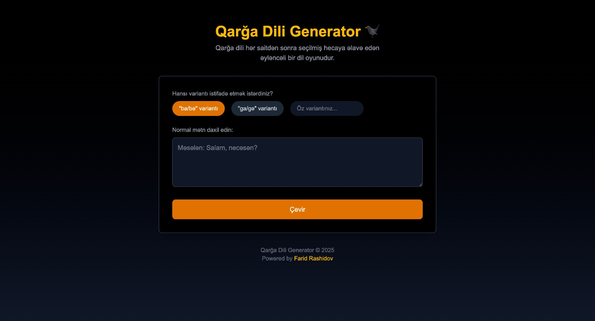

# Qarğa Dili Generator

Qarğa Dili Generator, Azərbaycanda yayılmış dil oyunu olan Qarğa dilini normal mətndən avtomatik yaradan veb tətbiqdir.

## Qarğa Dili nədir?

Qarğa dili hər saitdən (a, ı, o, u, e, ə, i, ö, ü) sonra "ba" və ya "ga" kimi bir hece əlavə etməklə yaradılan dil oyunudur. Məqsəd sözləri elə dəyişməkdir ki, yalnız bu oyunu bilənlər anlasın.

Əlavə olunan hece saitin qalın və ya incə olmasına uyğunlaşır: qalın saitdən sonra "ba", incə saitdən sonra "bə" gəlir.

Məsələn:

- "Salam" → "Sabalabam"
- "Necəsən?" → "Nebəcəbəsəbən?"
- "Mən məktəbə gedirəm." → "Məbən məbəktəbəbəbə gebədibərəbəm."

## Özəlliklər

- Normal mətni Qarğa Dilinə çevirmə
- Fərqli variantlar (ba, ga və ya öz hecanız)
- Mobil cihazlara uyğun dizayn
- Nəticəni bir kliklə köçürmə

## Ekran görüntüləri



## Texnologiyalar

- Next.js 15
- React 19
- Tailwind CSS 4
- TypeScript

## İstifadə qaydası

1. Bir mətn daxil edin
2. Variantınızı seçin (ba, ga və ya öz hecanız)
3. Nəticə yanda avtomatik görünür
4. "Köçür" düyməsi ilə nəticəni köçürün

## Quraşdırma

```bash
# Layihəni klonlayın
git clone https://github.com/imrashidov/qarga-dili-generator.git
cd qarga-dili-generator

# Asılılıqları yükləyin
npm install

# İnkişaf serverini işə salın
npm run dev
```

Tətbiqi görmək üçün brauzerdə [http://localhost:3000](http://localhost:3000) ünvanını açın.

## Struktur
```bash
├── .gitignore
├── README.md
├── app
    ├── lib
    │   └── qarga.ts
    ├── offline
    │   └── page.tsx
    ├── globals.css
    ├── layout.tsx
    ├── not-found.tsx
    └── page.tsx
├── eslint.config.mjs
├── next-sitemap.config.js
├── next.config.ts
├── package-lock.json
├── package.json
├── postcss.config.mjs
├── public
    ├── apple-touch-icon.png
    ├── fallback-70E608-7jGm1o7CiHtX2H.js
    ├── favicon-96x96.png
    ├── favicon.ico
    ├── favicon.svg
    ├── images
    │   ├── bug.svg
    │   └── og-image.png
    ├── manifest.json
    ├── robots.txt
    ├── site.webmanifest
    ├── sitemap-0.xml
    ├── sitemap.xml
    ├── sw.js
    ├── web-app-manifest-192x192.png
    ├── web-app-manifest-512x512.png
    └── workbox-f52fd911.js
├── screenshots
    └── screenshot.jpeg
├── tailwind.config.ts
└── tsconfig.json
```

## Lisenziya

MIT
